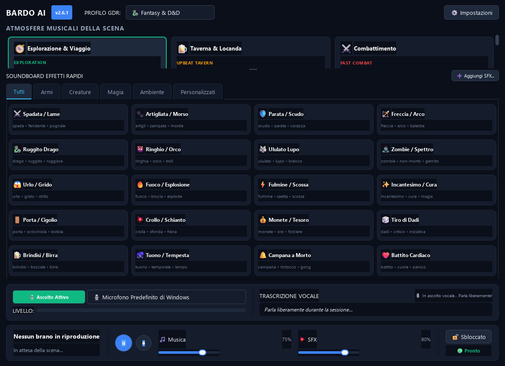
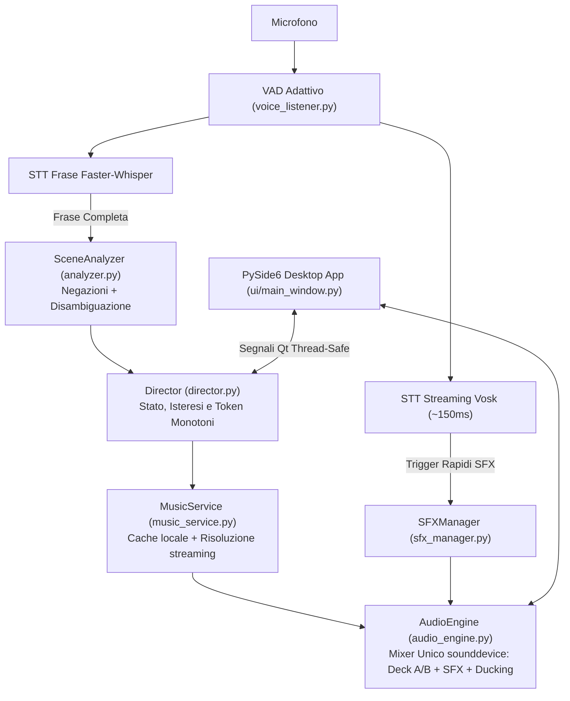

# Bardo AI (v2.6)

[](https://github.com/Il-Basta-Paolo/BardoAI/actions/workflows/tests.yml)
[](https://github.com/Il-Basta-Paolo/BardoAI/releases/latest)
[](tests/)
[](CHANGELOG.md)
[](LICENSE)

**Regia musicale automatica ed effetti sonori vocali per sessioni GdR**

Quando fai il Dungeon Master al tavolo o su Discord, gestire la colonna sonora è sempre un incubo: mentre descrivi una scena concitata devi cambiare finestra, cercare la traccia giusta su YouTube o Spotify, abbassare il volume, far partire il suono di una spada... e il ritmo della narrazione si spezza.

**Bardo AI** è un progetto realizzato in vibecoding che risolve questo problema: ascolta la tua voce mentre narri in italiano, capisce cosa sta succedendo al tavolo e adatta la musica e gli effetti sonori in tempo reale, senza che tu debba toccare il mouse.

<p align="center">
  
</p>

---

## Come funziona

1. **Ascolto vocale offline (zero dati inviati all'esterno)**  
   Il riconoscimento vocale gira interamente in locale sul tuo computer grazie a **Vosk** (per gli effetti sonori immediati, ~150ms di latenza) e **Faster-Whisper** (per trascrivere le frasi complete e capire quando cambiare scena). Nessun abbonamento, nessun server remoto, nessun costo API.

2. **Capisce il contesto (e soprattutto le negazioni!)**  
   Se dici *"I goblin estraggono le spade e caricano!"*, parte la musica da combattimento e senti il clangore delle armi. Ma se dici *"Tranquilli, non estraete le spade, non c'è nessun pericolo"*, il sistema riconosce la negazione e non fa partire per sbaglio il caos. Riconosce anche falsi allarmi comuni come *"vi danno il benvenuto"* (verbo dare, non danno subito) o *"intorno al fuoco"* (bivacco, non incendio).

3. **Mixer audio fluido con ducking automatico**  
   Tutto l'audio passa da un motore interno leggero (basato su PyAV e sounddevice). Quando parte un effetto sonoro (un colpo di spada, un ruggito, un tiro di dadi), la musica di sottofondo si abbassa leggermente in automatico per farlo risaltare, per poi tornare al volume normale. Le transizioni tra le scene sono dissolvenze morbide, senza salti o interruzioni brusche.

4. **4 Profili di campagna già pronti**
   - **Fantasy & D&D**: esplorazione, combattimento, boss fight, taverna, dungeon, riposo, mistero.
   - **Horror & Il Richiamo di Cthulhu**: indagini cupe, tensione crescente, follia, rifugio sicuro.
   - **Sci-Fi & Cyberpunk**: metropoli al neon, infiltrazione stealth, sparatorie cibernetiche, spazio profondo.
   - **Giallo & Investigativo**: scena del crimine, interrogatori serrati, inseguimenti, caso risolto.

5. **Soundboard integrata**  
   Include 20 effetti sonori stereo di default (armi, magie, creature, ambiente). Oltre ad attivarli parlando, puoi cliccarli al volo dall'interfaccia a schede o aggiungere i tuoi file audio (.wav, .mp3, .ogg) trascinandoli nella cartella dei suoni personalizzati.

---

## Novità dell'ultima versione (v2.6.3)

- **Avanzamento Continuo della Musica a Fine Brano**: monitoraggio dello stato di riproduzione con passaggio automatico alla traccia successiva dell'atmosfera attiva con dissolvenza incrociata morbida, eliminando il silenzio improvviso al tavolo quando un brano finisce.
- **Rotazione Tracce Intelligente & Skip senza Loop**: il pulsante "Salta Traccia" (⏭️) e le ricerche online memorizzano gli ultimi brani suonati e scelgono un candidato differente tra quelli disponibili, evitando di riavviare lo stesso brano dall'inizio.
- **Supporto Playlist Dedicate nei Singoli Mood (`custom_playlist`)**: ogni atmosfera può ora riprodurre direttamente una playlist YouTube o Spotify specifica indicata dall'utente nelle impostazioni, prima di ricorrere a seed o query generiche.
- **Regia AI Cloud/Locale Collegata alla Trascrizione Vocale**: la pipeline asincrona opzionale con **Google Gemini** (`gemini-2.5-flash`), **OpenAI** (`gpt-4o-mini`) o **Ollama** locale (`llama3.2`) è ora interamente collegata all'analisi vocale in background, preservando zero latenza sui comandi diretti e sulle parole di pericolo.
- **Autoricovero Modelli Vocali Vosk & Faster-Whisper**: introdotto il ripristino con download automatico pulito se la cartella di Vosk risulta incompleta o corrotta, e allineato il parametro `whisper_model` (`small`, `base`, `tiny`) con la configurazione.
- **Integrazione YouTube Music con Accesso Rapido (1 Clic)**: nuovo sistema di collegamento sicuro tramite finestra browser per accedere alle proprie playlist personali e preferiti direttamente da YouTube Music, salvando le credenziali di sessione in locale e bypassando qualsiasi restrizione d'accesso ospite.
- **Dismissione Completa di Spotify**: rimossa definitivamente la vecchia integrazione con Spotify, eliminando la necessità di un account Spotify Premium, delle chiavi API per sviluppatori (Client ID, Secret, Redirect URI) e del server OAuth locale. La riproduzione musicale è ora affidata interamente all'ecosistema nativo, gratuito e senza limiti di YouTube Music.
- **Scheda Intelligenza Artificiale Dinamica (Offline di Default + Opzioni Cloud/Locali)**: interfaccia impostazioni riorganizzata con selettore dinamico che mostra solo i campi pertinenti al provider scelto. La modalità predefinita opera al 100% offline tramite regole semantiche italiane e modelli vocali locali (Vosk/Whisper, zero cloud), con la possibilità opzionale di configurare modelli esterni come **Google Gemini** (`gemini-2.5-flash`), **OpenAI** (`gpt-4o-mini` con base URL personalizzabile) o server locali **Ollama** (`llama3.2`).
- **Mini-Player Auto-Float PiP Perfezionato**: layout compatto ottimizzato (540x84) ad altissima leggibilità con controlli essenziali (tasto rapido microfono, volume e ripristino) e protezione attiva da finestre di dialogo modali o minimizzazione a barra delle applicazioni.
- **Sincronizzazione Bidirezionale dei Volumi**: allineamento persistente dei livelli audio di musica ed effetti sonori tra configurazione, audio engine e slider della barra di trasporto.
- **Aggiornamento Dipendenze e Robustezza Packaging**: aggiunta la dipendenza `websocket-client>=1.8.0` in `requirements.txt` e `BardoAI.spec`, aggiornate le librerie di sistema (`sounddevice`, `keyring`, `pydantic`, `pillow`, `onnxruntime`), inclusione deterministica di tutte le finestre di dialogo nel bundle di compilazione PyInstaller e isolamento completo del Credential Manager nei test unitari.

<details>
<summary><b>Visualizza le novità delle release precedenti (v2.6.1 e v2.6.0)</b></summary>

### Novità v2.6.1
- **Sincronizzazione perfetta tra selettore profilo e griglia atmosfere all'avvio**: risolta l'anomalia per cui aprendo l'app il menu a tendina mostrava "Fantasy & D&D" mentre la griglia delle atmosfere sottostante mostrava quelle di Cyberpunk (o dell'ultimo profilo salvato).
- **Suite di collaudo dedicata per la UI**: introdotti test unitari offscreen in `tests/test_ui_profile_sync.py` per verificare l'allineamento automatico dei profili su macchina vergine e prevenire regressioni visive.

### Novità v2.6.0
- **Interfaccia desktop nativa in PySide6 (Qt6)**: addio al browser e al server web locale. Programma desktop Windows nativo, fluido, con supporto High-DPI e tema dark curato.
- **Motore audio interno (sounddevice + PyAV)**: rimosso LibVLC e le relative DLL esterne. Mixer interno a 48kHz stereo con dissolvenze incrociate naturali e audio ducking.
- **Riconoscimento vocale 100% offline**: pipeline combinata con Vosk e Faster-Whisper. Zero invio di registrazioni vocali all'esterno, zero costi di API.
- **Parsing semantico con gestione delle negazioni**: il motore analizza clausola per clausola la narrazione del Master escludendo frasi negate come *"non ci sono mostri"*.
- **Disambiguazione lessicale italiana**: rimossi tutti i falsi positivi su omografi comuni come *"vi danno il benvenuto"*, *"intorno al fuoco"*, *"costa dieci monete"*.
- **Sicurezza e archiviazione credenziali**: chiavi opzionali salvate in modo cifrato nel Credential Manager di Windows tramite `keyring`.
- **4 Profili di campagna completi**: Fantasy/D&D, Horror/Cthulhu, Sci-Fi/Cyberpunk, Giallo/Investigativo.
- **Eseguibili ufficiali e installer guidato**: disponibili sia la versione standalone portatile (`BardoAI.exe`) sia il setup Windows (`BardoAI_Setup.exe`).
</details>

> Consulta il file [`CHANGELOG.md`](CHANGELOG.md) per l'archivio completo e storico di tutti i cambiamenti.

---

## Perché Bardo AI (Confronto con le alternative)

Gestire l'audio durante una sessione di gioco di ruolo dal vivo o su Discord richiede spesso compromessi. Esistono strumenti eccellenti sul mercato, ma ciascuno è pensato per un flusso di lavoro differente:

| Caratteristica | Bardo AI | Spotify / YouTube | Kenku FM | Syrinscape |
| :--- | :--- | :--- | :--- | :--- |
| **Controllo al tavolo** | **A voce (hands-free)**: ascolta la narrazione | Manuale (Alt-Tab continuo su finestre esterne) | Manuale (click su interfaccia o bot Discord) | Manuale (click su macro e soundset dedicati) |
| **Comprensione del parlato** | **Sì (locale)**: distingue descrizioni ed esclude negazioni | No | No | No |
| **Effetti Sonori (SFX)** | **Istantanei da voce** (~150ms) o click | Ricerca manuale su playlist o video | Soundboard manuale a pulsanti | Pulsanti per campioni audio parametrici |
| **Audio Ducking automatico** | **Sì**: attenua la musica quando parli o parte un SFX | No (richiede regolazione manuale del mixer) | No | Sì (all'interno del mixer proprietario) |
| **Funzionamento offline** | **Sì**: STT e motore audio completamente in locale | No (richiede connessione costante e account) | Sì (per file locali salvati su disco) | Parziale (richiede download soundset proprietari) |
| **Interruzione del ritmo** | **Zero**: il DM narra senza togliere le mani dal tavolo | Alta (cercare brani, saltare pubblicità) | Media (gestione bot e tracce) | Media (interfaccia complessa con decine di pulsanti) |
| **Licenza e Costi** | **100% Gratuito & Open Source (MIT)** | Abbonamento mensile / Pubblicità | Acquisto una tantum (~$5) | Abbonamento mensile (~$11/mese) o pacchetti a pagamento |

> **La filosofia di Bardo AI**: Syrinscape eccelle nella complessità dei paesaggi sonori cinematici, Kenku FM è perfetto per trasmettere tracce audio su Discord con una soundboard manuale, e Spotify offre un catalogo sconfinato. Bardo AI non cerca di sostituire questi strumenti sul loro terreno, ma risolve un problema diverso e specifico: **permettere al Dungeon Master di narrare liberamente senza mai spezzare il contatto visivo con i giocatori per toccare mouse e tastiera**.

---

## Architettura del Sistema



### Moduli Principali

| Modulo | Descrizione e Responsabilità |
| :--- | :--- |
| [`desktop_app.py`](desktop_app.py) | Entry point dell'applicazione desktop in PySide6 (Qt6) con supporto High-DPI. |
| [`ui/`](ui/) | Componenti grafici dell'interfaccia: griglia atmosfere, soundboard, barra di trasporto e monitor vocale. |
| [`director.py`](director.py) | Cabina di regia centrale: gestisce lo stato della scena con isteresi temporale e token monotoni anti-race condition. |
| [`audio_engine.py`](audio_engine.py) | Mixer audio stereo float32 a 48kHz basato su PyAV e sounddevice, con dissolvenze S-Curve e audio ducking automatico. |
| [`sfx_manager.py`](sfx_manager.py) | Gestore della soundboard: caricamento suoni in RAM, matching esatto a parole intere e gestione effetti personalizzati. |
| [`analyzer.py`](analyzer.py) | Analizzatore semantico: separa clausole affermative e negative, disambigua gli omografi e gestisce il veto di pericolo. |
| [`music_service.py`](music_service.py) | Ricerca e risoluzione tracce musicali con filtro per brani strumentali e cache su disco. |
| [`ytdlp_manager.py`](ytdlp_manager.py) | Gestore dell'eseguibile esterno `yt-dlp` aggiornabile in background senza ricompilare l'app. |
| [`voice_listener.py`](voice_listener.py) | Cattura microfonica continua con VAD e pipeline di trascrizione locale (Vosk + Faster-Whisper). |
| [`storage.py`](storage.py) | Persistenza delle configurazioni con scritture atomiche e salvataggio credenziali cifrate tramite Windows Credential Manager (`keyring`). |
| [`config_defaults.py`](config_defaults.py) | Configurazioni predefinite e catalogo dei 4 profili di gioco (Fantasy, Horror, Sci-Fi, Investigativo). |

> Per approfondire le motivazioni tecniche, i compromessi e le alternative scartate nello sviluppo, consulta il [Registro delle Decisioni Architetturali (ADR)](docs/adr/README.md).

---

## Come iniziare

### Opzione 1: Eseguibile pronto all'uso (Windows)
Se vuoi solo usare il programma senza configurare Python:
1. Scarica l'ultima versione da [Releases](https://github.com/Il-Basta-Paolo/BardoAI/releases).
2. Puoi scegliere l'installer guidato (`BardoAI_Setup.exe`) che crea le scorciatoie su Desktop e Menu Start, oppure l'eseguibile standalone portatile (`BardoAI.exe`).
3. Avvia il programma, seleziona il microfono nelle Impostazioni e inizia a narrare.

> **Nota al primo avvio:** la prima volta che apri l'app, verranno scaricati in automatico nella tua cartella utente i modelli vocali leggeri e il componente per lo streaming musicale. Ci vogliono un paio di minuti, poi il programma è pronto.

---

### Opzione 2: Esecuzione da codice sorgente

Se vuoi modificare il codice o avviarlo tramite Python (versione 3.11 raccomandata):

```powershell
# 1. Clona la repository
git clone https://github.com/Il-Basta-Paolo/BardoAI.git
cd BardoAI

# 2. Crea e attiva un virtual environment
python -m venv .venv
.\.venv\Scripts\Activate.ps1

# 3. Installa le dipendenze
pip install -r requirements.txt

# 4. Avvia l'applicazione
python desktop_app.py
```

Per eseguire i test automatici:
```powershell
python -m pytest -v
```
*(54 test unitari e di corpus semantico coprono parsing delle negazioni, mixer audio, soundboard, sincronizzazione profili UI e logica di regia).*

> 💡 **Hai dubbi su come instradare l'audio su Discord, sui rumori dei dadi al tavolo o sull'uso offline?**  
> Consulta la guida alle [Domande Frequenti (FAQ)](docs/FAQ.md).

---

## Requisiti di sistema

-0078D6?logo=windows&logoColor=white)


| Componente | Requisito Minimo | Consigliato |
| :--- | :--- | :--- |
| **Sistema Operativo** | Windows 10 (64-bit) | Windows 11 (64-bit) |
| **Processore (CPU)** | Dual-Core 2.0 GHz (x86_64) | Quad-Core 2.5 GHz o superiore (Intel / AMD) |
| **Memoria RAM** | 4 GB *(consumo a riposo ~400 MB)* | 8 GB |
| **Spazio su Disco** | ~800 MB *(inclusi modelli vocali Vosk e Whisper)* | ~2 GB *(con cache tracce musicali locali)* |
| **Dispositivo Audio** | Qualsiasi microfono USB, jack o integrato | Microfono cardioide direzionato verso il Master |
| **Connessione Internet** | Necessaria al 1° avvio (modelli) e per lo streaming | Connessione broadband per streaming fluido (o offline completo con tracce in cache) |

---

## Crediti e Ringraziamenti
- **Autore**: Paolo Basta ([@Il-Basta-Paolo](https://github.com/Il-Basta-Paolo)).
- **Effetti Sonori**: ringraziamenti speciali ai team open source di [The Battle for Wesnoth](https://www.wesnoth.org/) e [Flare RPG](https://flarerpg.org/) per i campioni audio distribuiti sotto licenze libere (GPLv2 e CC-BY-SA 3.0 / CC0). L'elenco dettagliato dei singoli campioni è disponibile in [`CREDITS.md`](CREDITS.md).
- **Librerie principali**: PySide6 (Qt6), sounddevice, PyAV (FFmpeg), Vosk, faster-whisper, yt-dlp.

---

## Licenza
Questo progetto è distribuito sotto licenza [MIT](LICENSE).
