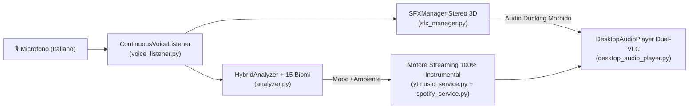

<div align="center">

# 🪕 Bardo AI
### Regia Musicale Automatica & Soundboard Vocale in Italiano per Giochi di Ruolo (D&D, Pathfinder, Call of Cthulhu, Cyberpunk)

[](https://github.com/Il-Basta-Paolo/BardoAI/releases/latest)
[-0284c7?style=for-the-badge&logo=windows)](https://github.com/Il-Basta-Paolo/BardoAI/releases/latest)
[](https://www.python.org/)
[](https://github.com/Il-Basta-Paolo/BardoAI)
[](LICENSE)

<br/>

**Bardo AI** ascolta la voce del Dungeon Master (o dei giocatori) in **Italiano** durante la sessione e gestisce in totale autonomia sia la **colonna sonora 100% strumentale** (con dissolvenze incrociate *S-Curve* da cinema) sia gli **effetti sonori (SFX)** in tempo reale.

### 👉 [**📥 SCARICA `BardoAI_Setup.exe` (Installer Completo per Windows)**](https://github.com/Il-Basta-Paolo/BardoAI/releases/latest)
*(Non richiede né Python né VLC Media Player: tutto il motore audio è già integrato nell'installer!)*

</div>

---

## ✨ Caratteristiche Principali

- 🎙️ **Ascolto Vocale Continuo in Italiano**: parla normalmente al tavolo o su Discord. Se dici *"Inizia il combattimento, tirate iniziativa!"* oppure *"State bruciando vivi nella trappola!"*, **Bardo AI** riconosce il pericolo e passa immediatamente a una traccia d'azione incalzante.
- 🏔️ **Reattività Istantanea a 15 Biomi e Ambienti Specifici**: prova a dire *"Siete in una valle innevata"*, *"Attraversate un deserto infinito"*, *"Vi addentrate nella palude nebbiosa"* o *"Salpate in alto mare"* — la musica cambia subito con brani **esclusivamente strumentali** (zero voci o parti cantate) cuciti sull'ambiente.
- ⚔️ **20 Effetti Sonori GdR Rimasterizzati in Stereo 3D + Soundboard Integrata**:
  - **Armi**: `⚔️ Spadata / Lame`, `🐾 Artigliata / Morso`, `🛡️ Parata / Scudo`, `🏹 Freccia / Dardo`
  - **Creature**: `🐉 Ruggito di Drago`, `👹 Ringhio di Mostro`, `🐺 Ululato di Lupo`, `🧟 Gemito Non-Morto`, `😱 Urlo di Terrore`
  - **Magia**: `🔥 Palla di Fuoco / Esplosione`, `⚡ Fulmine / Elettricità`, `✨ Incantesimo / Guarigione`
  - **Ambiente & Tavolo**: `🚪 Porta che Scricchiola`, `🪨 Crollo / Frana`, `🪙 Monete d'Oro / Tesoro`, `🎲 Lancio di Dadi (D20)`, `🍺 Brindisi di Locanda`, `🌩️ Tuono / Tempesta`, `🔔 Campana a Morto`, `💓 Battito Cardiaco`
  - Ogni effetto parte **automaticamente con la voce** (es. *"L'orco ringhia e ti colpisce con la sua spada!"*) oppure cliccando sulla **Soundboard 4×5** sempre visibile.
- 🌊 **Crossfade S-Curve a 50Hz & Audio Ducking Naturale**:
  - Doppio player audio indipendente con dissolvenza incrociata cosinusoidale fluida.
  - **Mastering Stereo Room/Hall** sugli effetti sonori e **curva di volume psicoacustica in dB**: gli effetti condividono lo stesso spazio acustico tridimensionale della musica senza mai suonare "staccati".
- 🟢 **Supporto Nativo Spotify & 🔴 YouTube Music**:
  - Funziona **subito senza bisogno di alcun account**.
  - Dalle **⚙️ Impostazioni** puoi scegliere se usare **Spotify** o **YouTube Music**, fare il **Login con 1 Click** tramite finestra integrata e incollare gli URL delle tue playlist preferite per ogni atmosfera.
- 🎭 **4 Profili di Gioco Preconfigurati** (completamente personalizzabili):
  1. 🐉 **Fantasy / D&D** (Esplorazione, Combattimento, Boss Epico, Locanda, Città, Dungeon, Mistero, Riposo, Viaggio)
  2. 🐙 **Horror / Call of Cthulhu** (Indagine, Tensione, Orrore Cosmico, Rifugio Sicuro)
  3. 🦾 **Sci-Fi / Cyberpunk** (Metropoli Neon, Infiltrazione, Sparatoria Cyber, Spazio Profondo)
  4. 🔍 **Giallo / Investigativo** (Scena del Crimine, Interrogatorio, Inseguimento, Deduzione)

---

## 🚀 Installazione Rapida (Per Dungeon Master e Giocatori)

1. Vai nella sezione [**Releases**](https://github.com/Il-Basta-Paolo/BardoAI/releases/latest) e scarica **`BardoAI_Setup.exe`**.
2. Avvia **`BardoAI_Setup.exe`**:
   - Scegli liberamente la cartella o il disco dove installare il programma (tramite il pulsante **📂 Sfoglia Cartella...** o i pulsanti rapidi).
   - Clicca su **🚀 Installa Bardo AI**.
3. Avvia **Bardo AI** dall'icona creata sul tuo **Desktop** o nel **Menu Start**!

> [!NOTE]
> Se Windows SmartScreen mostra un avviso al primo avvio (normale per i programmi indie open-source non firmati con certificato aziendale Microsoft), clicca su **"Ulteriori informazioni"** e poi su **"Esegui comunque"**.

---

## 🛠️ Architettura del Progetto



| File | Descrizione |
| :--- | :--- |
| [`desktop_app.py`](desktop_app.py) | Interfaccia grafica principale CustomTkinter a geometria bloccata (zero flicker) |
| [`desktop_audio_player.py`](desktop_audio_player.py) | Doppio motore LibVLC con Crossfade S-Curve a 50Hz e Audio Ducking proporzionale |
| [`sfx_manager.py`](sfx_manager.py) | Motore PCM Stereo in-memory a latenza zero (`sounddevice`) con curva di volume psicoacustica |
| [`analyzer.py`](analyzer.py) | Analizzatore semantico in Italiano (negazioni, priorità di pericolo, 15 biomi ambientali + AI opzionale) |
| [`spotify_service.py`](spotify_service.py) | Integrazione Spotify (Login 1-Click, importazione playlist e risoluzione tracce complete) |
| [`ytmusic_service.py`](ytmusic_service.py) | Integrazione YouTube Music con filtro rigoroso `100% Instrumental` (anti-vocal/anti-cantato) |
| [`build_sfx_library.py`](build_sfx_library.py) | Generatore e processore acustico FFT + Stereo Room Reverb per i 20 effetti sonori `sfx/*.wav` |
| [`installer_gui.py`](installer_gui.py) | Setup Wizard grafico di installazione per Windows (`BardoAI_Setup.exe`) |
| [`build_installer.py`](build_installer.py) | Script automatico per compilare `BardoAI.exe` e impacchettare `BardoAI_Setup.exe` con LibVLC integrato |

---

## 💻 Esecuzione da Codice Sorgente (Per Sviluppatori)

Se preferisci avviare o modificare **Bardo AI** direttamente da Python:

```powershell
# 1. Clona il repository
git clone https://github.com/Il-Basta-Paolo/BardoAI.git
cd BardoAI

# 2. Crea l'ambiente virtuale e installa le dipendenze
python -m venv .venv
.\.venv\Scripts\pip install -r requirements.txt

# 3. Avvia l'applicazione desktop
.\.venv\Scripts\python desktop_app.py
```

Per rigenerare l'eseguibile `BardoAI.exe` e l'installer completo `BardoAI_Setup.exe`:
```powershell
.\.venv\Scripts\python build_installer.py
```

---

## 📜 Licenza

Distribuito sotto licenza **MIT**. Consulta il file [`LICENSE`](LICENSE) per maggiori dettagli.
