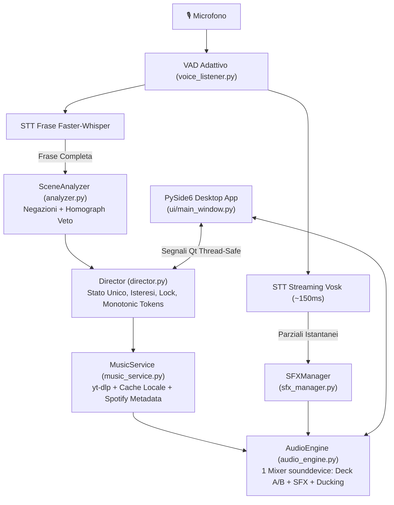

<div align="center">

# 🪕 Bardo AI v2.6.0
### Regia Musicale Intelligente & Soundboard Vocale per Giochi di Ruolo

[](https://github.com/Il-Basta-Paolo/BardoAI/releases/latest)
[-0284c7?style=for-the-badge&logo=windows)](https://github.com/Il-Basta-Paolo/BardoAI/releases/latest)
[](https://www.python.org/)
[-41cd52?style=for-the-badge&logo=qt)](https://www.qt.io/)
[](LICENSE)

<br/>

**Bardo AI** è la regia musicale autonoma e soundboard vocale per Dungeon Master e giocatori. Ascolta la voce al tavolo in **italiano**, riconosce il contesto della scena ed effettua il cambio di colonna sonora (100% strumentale, dissolvenze *S-Curve* sample-accurate) e l'attivazione immediata degli effetti sonori (spade, magie, mostri, dadi) a latenza zero tramite Speech-to-Text 100% locale.

</div>

---

## ✨ Caratteristiche di Bardo AI v2.6.0

- 🎙️ **Speech-to-Text 100% Locale & Offline**:
  - Streaming a bassissima latenza (~150-200ms) tramite **Vosk** per l'attivazione immediata degli SFX pronunciati a voce.
  - Trascrizione di fine frase ad alta precisione tramite **Faster-Whisper** per la regia e il cambio d'atmosfera.
  - Zero limiti di token e piena privacy (funziona anche senza connessione internet).
- 🧠 **Analizzatore Semantico con Parsing delle Negazioni**:
  - Distinzione clausola per clausola tra affermazioni e negazioni: se il DM dice *"Non c'è nessun pericolo, siamo al sicuro"* o *"Non tirate i dadi"*, i trigger di combattimento e gli SFX **non** scattano.
  - Disambiguazione di omografi lessicali: nessuna falsa attivazione da espressioni come *"vi danno il benvenuto"* (dare), *"intorno al fuoco"* (bivacco accogliente), *"costa dieci monete"* (prezzo, non bioma mare), *"lo farò"* (fare, non faro marittimo), *"è reale"* (realtà, non castello).
  - Veto di pericolo istantaneo: situazioni critiche e comandi del master prevalgono immediatamente sulla calma.
- 🎛️ **Audio Engine Unificato a Mixer Singolo (`sounddevice` + PyAV)**:
  - Addio dipendenze esterne da LibVLC e plugin DLL di terze parti: PyAV decodifica direttamente flussi audio PCM a 48kHz stereo float32.
  - Crossfade Coseno S-Curve sample-accurate che riparte dall'esatto guadagno corrente (zero salti di volume).
  - Audio Ducking automatico sample-accurate della musica quando scatta un effetto sonoro.
  - Soft-knee limiter (`np.tanh`) per evitare clipping digitale anche durante scene caotiche con più effetti simultanei.
- 🎭 **4 Profili di Gioco Preconfigurati**:
  1. 🐉 **Fantasy & D&D**: Esplorazione, Combattimento, Boss Epico, Locanda/Taverna, Città, Dungeon, Mistero, Riposo, Viaggio.
  2. 🐙 **Horror & Call of Cthulhu**: Indagine, Tensione, Follia Cosmica, Fuga Disperata, Rifugio Sicuro.
  3. 🦾 **Sci-Fi & Cyberpunk**: Metropoli Neon, Infiltrazione, Sparatoria Cyber, Spazio Profondo, Wasteland.
  4. 🔍 **Giallo & Investigativo**: Scena del Crimine, Interrogatorio Serrato, Inseguimento, Deduzione & Archivio, Caso Risolto.
- 💥 **Soundboard Dinamica a Categorie & SFX Personalizzati**:
  - Griglia responsiva che mostra tutti i 20 effetti inclusi più eventuali suoni personalizzati (senza limiti di visualizzazione).
  - Cartella custom sicura in `%APPDATA%\BardoAI\data\custom_sfx` (nessun errore di permessi in Program Files).
  - Aggiunta guidata di effetti custom (WAV, MP3, OGG, FLAC) con parole chiave per attivarli a voce.
- 🔐 **Sicurezza e Credential Manager di Windows**:
  - Le API key (Gemini, OpenAI, Spotify) vengono archiviate in modo cifrato nel Windows Credential Manager tramite `keyring`. Nessuna chiave salvata in chiaro nei file JSON.
  - Salvataggi atomici con file temporanei per prevenire corruzioni di configurazione.

---

## 🛠️ Architettura di Bardo AI v2.6.0



| Modulo | Ruolo nell'architettura v2 |
| :--- | :--- |
| [`desktop_app.py`](desktop_app.py) | Entry point applicativo PySide6 con supporto High-DPI |
| [`ui/`](ui/) | Interfaccia Qt6 modulare (MoodGrid, Soundboard a schede, TransportBar, VoiceMonitor, SettingsDialog) |
| [`director.py`](director.py) | Macchina a stati centrale con lock, isteresi di de-escalation e token monotoni |
| [`audio_engine.py`](audio_engine.py) | Mixer stereo float32 unico a 48kHz (PyAV + sounddevice, crossfade S-Curve, ducking, limiter) |
| [`sfx_manager.py`](sfx_manager.py) | Soundboard PCM in-memory, matching esatto `\bparola\b`, esclusione clausole negate |
| [`analyzer.py`](analyzer.py) | Parser di negazioni, disambiguazione omografi, veto di pericolo, 15 biomi puliti |
| [`music_service.py`](music_service.py) | Risoluzione tracce con regex a confini di parola (anti-vocal), cache LRU e fallback locale |
| [`ytdlp_manager.py`](ytdlp_manager.py) | Gestione eseguibile esterno yt-dlp aggiornabile, lock per-video e supporto SponsorBlock |
| [`voice_listener.py`](voice_listener.py) | Cattura microfono thread-safe, pipeline duale Vosk + Faster-Whisper offline |
| [`storage.py`](storage.py) | Modelli Pydantic v2, scritture atomiche e credenziali cifrate tramite `keyring` |
| [`config_defaults.py`](config_defaults.py) | Schema v2, 4 profili GdR completi, cataloghi keyword e seed tracks strumentali |

---

## 🧪 Test Suite Automatica

Il progetto include una suite completa di test con **pytest** che verifica tutti gli aspetti critici del motore audio, del parsing semantico e della regia:

```powershell
# Esecuzione dell'intera suite di test (49 test unitari e corpus)
.\.venv\Scripts\python -m pytest -v
```

Risultato: **49 passed in ~2.0s (100% pass rate)**.

---

## 💻 Esecuzione da Codice Sorgente

```powershell
# 1. Clona il repository
git clone https://github.com/Il-Basta-Paolo/BardoAI.git
cd BardoAI

# 2. Crea l'ambiente virtuale e installa le dipendenze
python -m venv .venv
.\.venv\Scripts\pip install -r requirements.txt

# 3. Avvia Bardo AI v2.6.0
.\.venv\Scripts\python desktop_app.py
```

---

## 📜 Licenze e Attribuzioni
- **Autore**: Paolo Basta ([@Il-Basta-Paolo](https://github.com/Il-Basta-Paolo))
- **Codice**: Distribuito sotto licenza [MIT](LICENSE).
- **Effetti Sonori**: Battle for Wesnoth (GPL-2.0-or-later) e Flare RPG (CC-BY-SA 3.0 / CC0). Consulta [`CREDITS.md`](CREDITS.md) per l'elenco completo delle attribuzioni.
