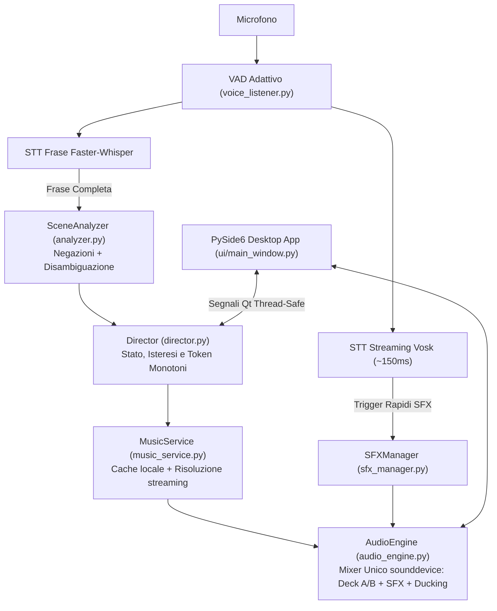

# Bardo AI (v2.6.0)

[](https://github.com/Il-Basta-Paolo/BardoAI/actions/workflows/tests.yml)
[](https://github.com/Il-Basta-Paolo/BardoAI/releases/latest)
[](CHANGELOG.md)
[](LICENSE)

**Regia musicale automatica ed effetti sonori vocali per sessioni GdR**

Quando fai il Dungeon Master al tavolo o su Discord, gestire la colonna sonora è sempre un incubo: mentre descrivi una scena concitata devi cambiare finestra, cercare la traccia giusta su YouTube o Spotify, abbassare il volume, far partire il suono di una spada... e il ritmo della narrazione si spezza.

**Bardo AI** risolve questo problema: ascolta la tua voce mentre narri in italiano, capisce cosa sta succedendo al tavolo e adatta la musica e gli effetti sonori in tempo reale, senza che tu debba toccare il mouse.

---

## Come funziona

1. **Ascolto vocale offline (zero dati inviati all'esterno)**  
   Il riconoscimento vocale gira interamente in locale sul tuo computer grazie a **Vosk** (per gli effetti sonori immediati, ~150ms di latenza) e **Faster-Whisper** (per trascrivere le frasi complete e capire quando cambiare scena). Nessun abbonamento, nessun server remoto, nessun costo API.

2. **Capisce il contesto (e soprattutto le negazioni!)**  
   Se dici *"I goblin estraggono le spade e caricano!"*, parte la musica da combattimento e senti il clangore delle armi. Ma se dici *"Tranquilli, non estraete le spade, non c'è nessun pericolo"*, il sistema riconosce la negazione e non fa partire per sbaglio il caos. Riconosce anche falsi allarmi comuni come *"vi danno il benvenuto"* (verbo dare, non danno subito) o *"intorno al fuoco"* (bivacco, non incendio).

3. **Mixer audio fluido con ducking automatico**  
   Tutto l'audio passa da un motore interno leggero (basato su PyAV e sounddevice). Quando parte un effetto sonoro (un colpo di spada, un ruggito, un tiro di dadi), la musica di sottofondo si abbassa leggermente in automatico per farlo risaltare, per poi tornare al volume normale. Le transizioni tra le scene sono dissolvenze morbide, senza salti o interruzioni brusche.

4. **4 Profili di campagna già pronti**
   - **Fantasy & D&D**: esplorazione, combattimento, boss fight, taverna, dungeon, riposo, mistero.
   - **Horror & Il Richiamo di Cthulhu**: indagini cupe, tensione crescente, follia, rifugio sicuro.
   - **Sci-Fi & Cyberpunk**: metropoli al neon, infiltrazione stealth, sparatorie cibernetiche, spazio profondo.
   - **Giallo & Investigativo**: scena del crimine, interrogatori serrati, inseguimenti, caso risolto.

5. **Soundboard integrata**  
   Include 20 effetti sonori stereo di default (armi, magie, creature, ambiente). Oltre ad attivarli parlando, puoi cliccarli al volo dall'interfaccia a schede o aggiungere i tuoi file audio (.wav, .mp3, .ogg) trascinandoli nella cartella dei suoni personalizzati.

---

## Novità dell'ultima versione (v2.6.0)

Con la versione 2.6.0 il progetto è stato completamente rifondato su un'architettura desktop nativa, eliminando la vecchia interfaccia web locale:

- **Interfaccia desktop nativa in PySide6 (Qt6)**: addio al browser e al server web locale. L'applicazione è ora un programma desktop Windows nativo, fluido, con supporto High-DPI e tema dark curato.
- **Motore audio interno (sounddevice + PyAV)**: rimosso LibVLC e le relative DLL esterne. Ora un unico mixer leggero gestisce la decodifica audio interna a 48kHz stereo, le dissolvenze incrociate naturali e l'audio ducking (la musica di sottofondo si attenua automaticamente all'attivazione degli effetti sonori).
- **Riconoscimento vocale 100% offline**: pipeline combinata con Vosk (latenza ~150ms per l'attivazione immediata degli effetti pronunciati a voce) e Faster-Whisper per la regia d'atmosfera. Zero invio di registrazioni vocali all'esterno, zero costi di API.
- **Parsing semantico con gestione delle negazioni**: il motore analizza clausola per clausola la narrazione del Master; frasi come *"non ci sono mostri"* o *"non estraete le spade"* non attivano più erroneamente combattimenti o effetti.
- **Disambiguazione lessicale italiana**: rimossi tutti i falsi positivi su omografi comuni come *"vi danno il benvenuto"* (verbo dare, non danno subito), *"intorno al fuoco"* (bivacco accogliente), *"costa dieci monete"* (prezzo, non mare).
- **Sicurezza e archiviazione credenziali**: rimossa ogni archiviazione in chiaro di token e cookie nei file JSON. Le chiavi opzionali (Gemini, Spotify, OpenAI) vengono salvate in modo cifrato nel Credential Manager di Windows tramite `keyring`.
- **4 Profili di campagna completi**: ambientazioni preconfigurate (Fantasy/D&D, Horror/Cthulhu, Sci-Fi/Cyberpunk, Giallo/Investigativo) con catalogo musicale e parole chiave dedicate.
- **Eseguibili ufficiali e installer guidato**: disponibili sia la versione standalone portatile (`BardoAI.exe`) sia il setup Windows (`BardoAI_Setup.exe`) con metadati e scorciatoie di sistema.

> Consulta il file [`CHANGELOG.md`](CHANGELOG.md) per l'archivio completo e storico di tutti i cambiamenti.

---

## Architettura del Sistema



### Moduli Principali

| Modulo | Descrizione e Responsabilità |
| :--- | :--- |
| [`desktop_app.py`](desktop_app.py) | Entry point dell'applicazione desktop in PySide6 (Qt6) con supporto High-DPI. |
| [`ui/`](ui/) | Componenti grafici dell'interfaccia: griglia atmosfere, soundboard, barra di trasporto e monitor vocale. |
| [`director.py`](director.py) | Cabina di regia centrale: gestisce lo stato della scena con isteresi temporale e token monotoni anti-race condition. |
| [`audio_engine.py`](audio_engine.py) | Mixer audio stereo float32 a 48kHz basato su PyAV e sounddevice, con dissolvenze S-Curve e audio ducking automatico. |
| [`sfx_manager.py`](sfx_manager.py) | Gestore della soundboard: caricamento suoni in RAM, matching esatto a parole intere e gestione effetti personalizzati. |
| [`analyzer.py`](analyzer.py) | Analizzatore semantico: separa clausole affermative e negative, disambigua gli omografi e gestisce il veto di pericolo. |
| [`music_service.py`](music_service.py) | Ricerca e risoluzione tracce musicali con filtro per brani strumentali e cache su disco. |
| [`ytdlp_manager.py`](ytdlp_manager.py) | Gestore dell'eseguibile esterno `yt-dlp` aggiornabile in background senza ricompilare l'app. |
| [`voice_listener.py`](voice_listener.py) | Cattura microfonica continua con VAD e pipeline di trascrizione locale (Vosk + Faster-Whisper). |
| [`storage.py`](storage.py) | Persistenza delle configurazioni con scritture atomiche e salvataggio credenziali cifrate tramite Windows Credential Manager (`keyring`). |
| [`config_defaults.py`](config_defaults.py) | Configurazioni predefinite e catalogo dei 4 profili di gioco (Fantasy, Horror, Sci-Fi, Investigativo). |

---

## Come iniziare

### Opzione 1: Eseguibile pronto all'uso (Windows)
Se vuoi solo usare il programma senza configurare Python:
1. Scarica l'ultima versione da [Releases](https://github.com/Il-Basta-Paolo/BardoAI/releases).
2. Puoi scegliere l'installer guidato (`BardoAI_Setup.exe`) che crea le scorciatoie su Desktop e Menu Start, oppure l'eseguibile standalone portatile (`BardoAI.exe`).
3. Avvia il programma, seleziona il microfono nelle Impostazioni e inizia a narrare.

> **Nota al primo avvio:** la prima volta che apri l'app, verranno scaricati in automatico nella tua cartella utente i modelli vocali leggeri e il componente per lo streaming musicale. Ci vogliono un paio di minuti, poi il programma è pronto.

---

### Opzione 2: Esecuzione da codice sorgente

Se vuoi modificare il codice o avviarlo tramite Python (versione 3.11 raccomandata):

```powershell
# 1. Clona la repository
git clone https://github.com/Il-Basta-Paolo/BardoAI.git
cd BardoAI

# 2. Crea e attiva un virtual environment
python -m venv .venv
.\.venv\Scripts\Activate.ps1

# 3. Installa le dipendenze
pip install -r requirements.txt

# 4. Avvia l'applicazione
python desktop_app.py
```

Per eseguire i test automatici:
```powershell
python -m pytest -v
```
*(50 test unitari e di corpus semantico coprono parsing delle negazioni, mixer audio, soundboard e logica di regia).*

---

## Requisiti di sistema
- **Sistema operativo**: Windows 10 o Windows 11 (64-bit).
- **Microfono**: qualsiasi microfono USB o integrato configurato su Windows.
- **Connessione Internet**: necessaria per lo streaming dei brani musicali e per il download iniziale dei modelli STT; gli effetti sonori e il motore audio funzionano anche completamente offline.

---

## Crediti e Ringraziamenti
- **Autore**: Paolo Basta ([@Il-Basta-Paolo](https://github.com/Il-Basta-Paolo)).
- **Effetti Sonori**: ringraziamenti speciali ai team open source di [The Battle for Wesnoth](https://www.wesnoth.org/) e [Flare RPG](https://flarerpg.org/) per i campioni audio distribuiti sotto licenze libere (GPLv2 e CC-BY-SA 3.0 / CC0). L'elenco dettagliato dei singoli campioni è disponibile in [`CREDITS.md`](CREDITS.md).
- **Librerie principali**: PySide6 (Qt6), sounddevice, PyAV (FFmpeg), Vosk, faster-whisper, yt-dlp.

---

## Licenza
Questo progetto è distribuito sotto licenza [MIT](LICENSE).
